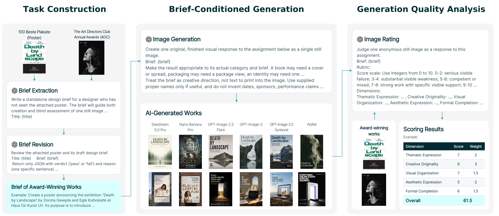
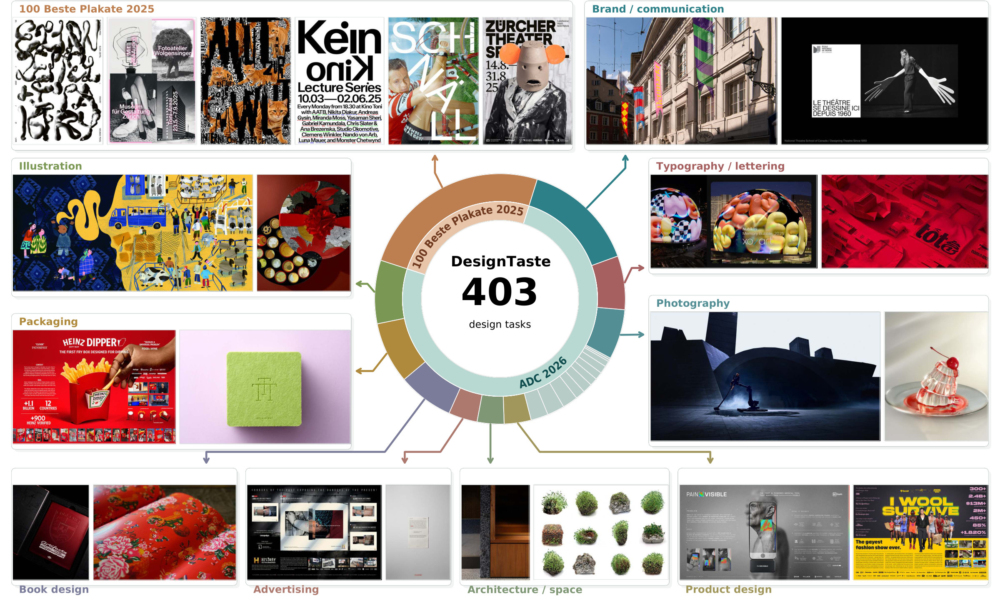
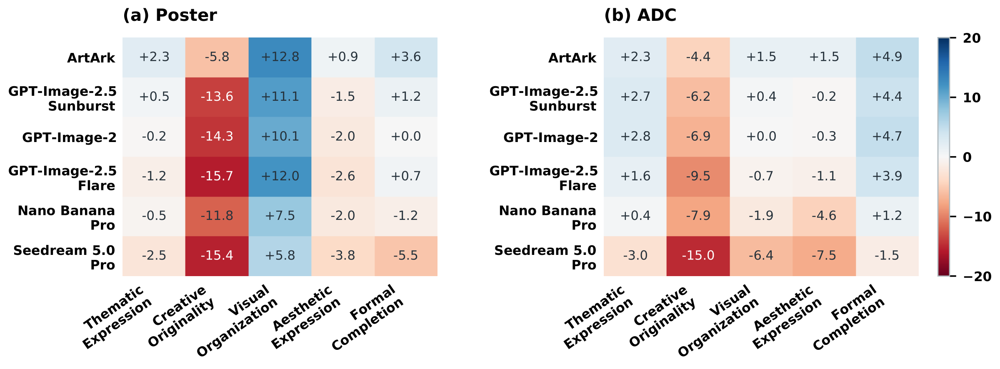
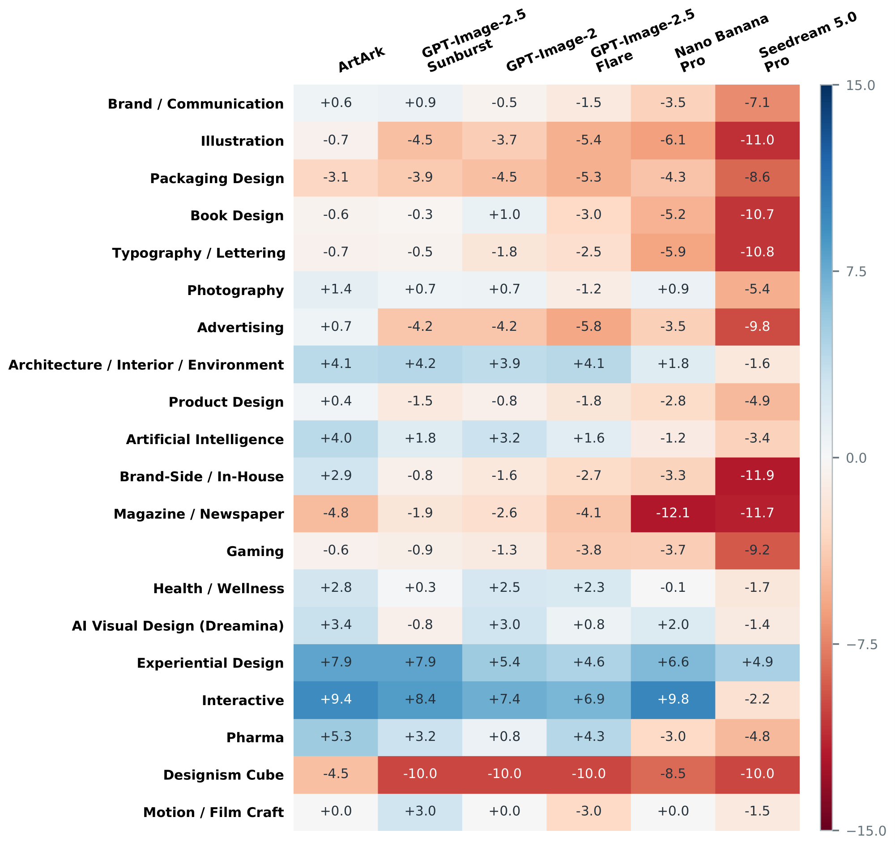
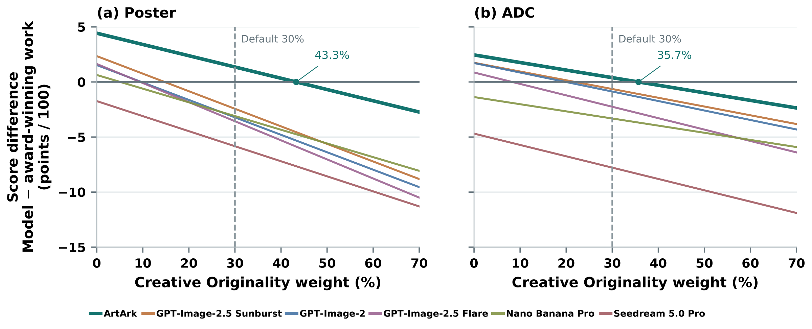
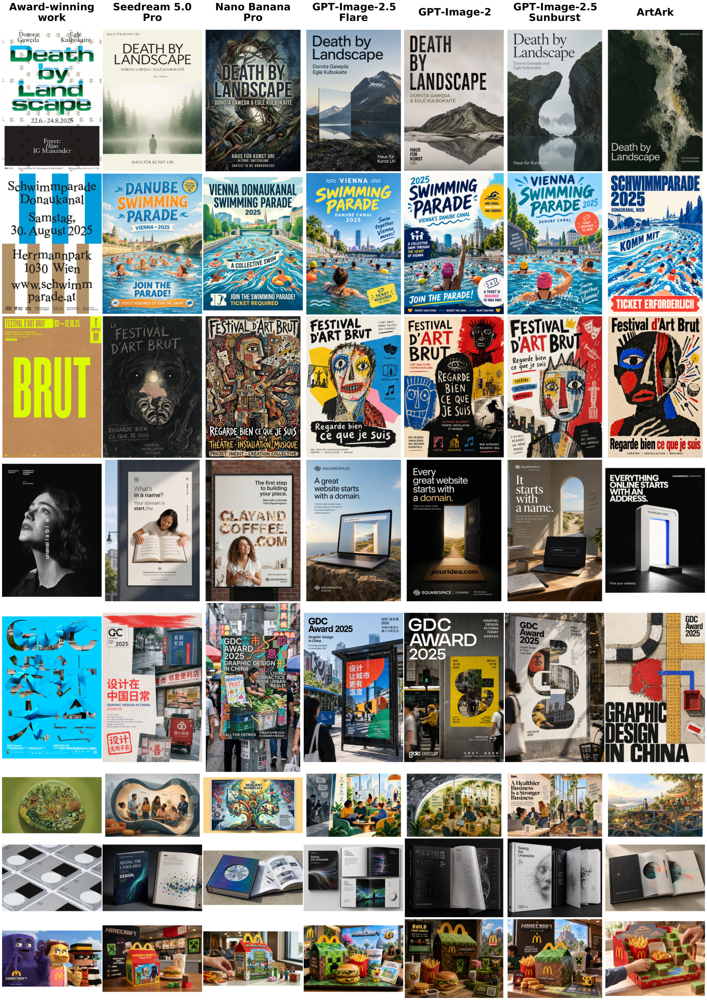

<p align="center">
  <picture>
    <source media="(prefers-color-scheme: dark)" srcset="assets/wordmark-dark.svg">
    
  </picture>
</p>

<h3 align="center">Benchmarking AI-Generated Visual Design<br>Against Award-Winning Works</h3>

<p align="center">
  <a href="#results"><b>Results</b></a> &nbsp;&middot;&nbsp;
  <a href="#quick-start"><b>Quick start</b></a> &nbsp;&middot;&nbsp;
  <a href="#benchmark"><b>Benchmark</b></a> &nbsp;&middot;&nbsp;
  <a href="#data"><b>Data</b></a> &nbsp;&middot;&nbsp;
  <a href="#citation"><b>Citation</b></a>
</p>

<p align="center">
  <b>403 design briefs</b> &nbsp;/&nbsp; <b>6 image models</b> &nbsp;/&nbsp; <b>5 evaluation dimensions</b>
</p>

DesignTaste compares AI-generated designs with award-winning works from **100 Beste Plakate 2025 (Poster)** and **ADC 2026**. Models receive the same short design brief, without seeing the original work. Each generated image and award-winning work is scored independently to assess both the design idea and how well it is expressed.

## Results

**A finished, visually appealing image does not necessarily make a good design solution.** Only ArtArk exceeds the award-winning works' mean overall score on both datasets. All six models score lower in **Creative Originality** on both datasets.

| Model / source | Poster | Difference | ADC | Difference |
| :--- | ---: | ---: | ---: | ---: |
| **Award-winning works** | 78.275 | - | 80.343 | - |
| Seedream 5.0 Pro | 72.440 | -5.835 | 72.566 | -7.777 |
| Nano Banana Pro | 75.180 | -3.095 | 77.028 | -3.315 |
| GPT-Image-2.5 Flare | 74.710 | -3.565 | 78.094 | -2.249 |
| GPT-Image-2 | 75.060 | -3.215 | 79.477 | -0.866 |
| GPT-Image-2.5 Sunburst | 75.840 | -2.435 | 79.705 | -0.639 |
| **ArtArk** | **79.635** | **+1.360** | **80.736** | **+0.393** |

Scores are on a **0-100 scale** with weights **2:3:1.5:2:1.5**. Difference is the model mean minus the award-winning mean. Bold scores mark the highest model mean. These are results under the benchmark's scoring protocol, not the original award juries' ratings.

**[Results workbook](data/results/DesignTaste_results.xlsx)** &middot; [Overall scores](data/results/summary.csv) &middot; [Dimension scores](data/results/dimensions.csv)

<details>
<summary><b>How often does each model score above the award-winning work?</b></summary>

Counts compare independently assigned scores for the same task. H / T / L means higher / tied / lower.

| Model | Poster H / T / L | ADC H / T / L |
| :--- | :---: | :---: |
| Seedream 5.0 Pro | 12 / 6 / 82 | 37 / 7 / 259 |
| Nano Banana Pro | 20 / 10 / 70 | 86 / 18 / 199 |
| GPT-Image-2.5 Flare | 13 / 10 / 77 | 98 / 9 / 196 |
| GPT-Image-2 | 18 / 7 / 75 | 118 / 17 / 168 |
| GPT-Image-2.5 Sunburst | 23 / 11 / 66 | 122 / 18 / 163 |
| ArtArk | 57 / 8 / 35 | 148 / 14 / 141 |

</details>

## Quick start

**Explore the released results without API keys or image downloads.** Requires Python 3.10 or newer.

```bash
git clone https://github.com/ArtArk-AI/DesignTaste.git
cd DesignTaste
python3 -m venv .venv
source .venv/bin/activate
python -m pip install -e . -r requirements.txt
```

Reproduce both comparisons from the released scores:

```bash
for track in poster adc
do
  python scripts/compare_scores.py \
    --track "$track" \
    --scores "data/annotations/${track}_scores.csv" \
    --weights 2:3:1.5:2:1.5 \
    --output "runs/${track}_summary.csv"
done
```

The two CSV files contain each model's mean score, difference from the award-winning works, and higher / tied / lower counts. Change `--weights` to explore another weighting without generating or judging images again.

| I want to... | Start here |
| :--- | :--- |
| Inspect the results | [Download the workbook](data/results/DesignTaste_results.xlsx) |
| Evaluate my model | [Submission guide](docs/SUBMISSIONS.md) |
| Generate, score, or export to Excel | [Reproduction guide](docs/REPRODUCING_RESULTS.md) |
| Understand the scoring | [Evaluation protocol](docs/EVALUATION.md) |

## Benchmark

### From award-winning works to design briefs

[](assets/benchmark-protocol.png)

1. **Prepare the brief.** Extract the subject, purpose, and supported facts from a work and its public background, then review the brief for accuracy and room for different solutions.
2. **Generate a design.** Give each model the same brief and applicable category information. The original work is not an input to generation.
3. **Score and compare.** Judge the generated image and the award-winning work independently, then compare their scores for the same task.

### Two complementary datasets

| Dataset | Tasks | Design scope |
| :--- | ---: | :--- |
| **Poster** | 100 | Poster design from 100 Beste Plakate 2025, focusing on imagery, typography, color, and composition. |
| **ADC** | 303 | 20 ADC 2026 categories, including branding, packaging, advertising, books, illustration, and spatial design. |

[](assets/dataset-overview.jpg)

*Orange denotes Poster, and teal denotes ADC and its design categories. Click to view the examples at full resolution.*

The briefs are derived from public materials, not the original client briefs. The ADC evaluation uses 303 of 333 tasks. One or more models declined generation on the remaining 30 because of content moderation. Each task is evaluated through one image. See the [dataset guide](docs/DATASET.md) for scope and file formats.

### Five evaluation dimensions

| Dimension | Evaluation focus | Weight |
| :--- | :--- | ---: |
| **Thematic Expression** | Coherent expression of the subject, mood, or purpose. | 20% |
| **Creative Originality** | A distinctive central idea, developed convincingly. | 30% |
| **Visual Organization** | Composition, hierarchy, spacing, and use of the medium. | 15% |
| **Aesthetic Expression** | Color, style, atmosphere, and visual impact. | 20% |
| **Formal Completion** | Coherent elements and details in the finished design. | 15% |

The dimension names are shared across datasets, while the detailed criteria reflect their different design tasks. The main judge, `gpt-6.1-sol`, receives one image, its brief, and the rubric without model identity or award status. It assigns five integer scores from 0 to 10. Reported scores are scaled to 0-100. The [evaluation guide](docs/EVALUATION.md) documents the formula, raw score IDs, and annotation provenance.

### Where the models fall short

[](assets/dimension-profiles.png)

All six models score higher in **Visual Organization** on Poster, yet lower in **Creative Originality** on both datasets. ArtArk scores higher in four dimensions on each dataset, but its originality deficit remains **5.8 points on Poster** and **4.4 points on ADC**. Positive values in the figure favor the model, and negative values favor the award-winning works.

<details>
<summary><b>ADC results by design category</b></summary>

[](assets/adc-category-results.png)

Model performance varies across design tasks. Values are model-minus-award-winning mean scores on the 0-100 scale. [Category scores and sample counts](data/results/adc_categories.csv).

</details>

<details>
<summary><b>Changing the weight of Creative Originality</b></summary>

[](assets/creativity-weight.png)

The curves vary the weight of Creative Originality while preserving the relative weights of the other dimensions. Every model's difference from the award-winning works decreases as originality receives more weight. The default weight is 30%.

</details>

<details>
<summary><b>Eight visual cases</b></summary>

[](assets/model-comparisons.jpg)

The first three rows are Poster tasks. The remaining five cover advertising, brand communication, illustration, book design, and gaming in ADC. Each row pairs an award-winning work with six model outputs generated from its brief. These are selected examples. The reported results use all 403 tasks.

</details>

## Data

The release includes **403 reviewed briefs** and **2,821 image-score records**: one award-winning work and six generated images per task.

| Resource | Poster | ADC |
| :--- | :--- | :--- |
| Task metadata | [100 tasks](data/manifests/poster.csv) | [303 tasks](data/manifests/adc.csv) |
| Reviewed briefs | [JSONL](data/briefs/poster.jsonl) | [JSONL](data/briefs/adc.jsonl) |
| Scoring criteria | [English](data/rubrics/poster.json) / [Chinese](data/rubrics/poster.zh.json) | [English](data/rubrics/adc.json) / [Chinese](data/rubrics/adc.zh.json) |
| Image scores | [700 records](data/annotations/poster_scores.csv) | [2,121 records](data/annotations/adc_scores.csv) |
| Prompts | [Poster](prompts/poster/) | [ADC](prompts/adc/) |

Task IDs and hashes connect the files. Selected paper figures are included in [assets/](assets/). Full reference and generated-image collections are not bundled. To evaluate a model, use the released briefs and provide one image per task as `<task_id>.png`. The bundled adapters are listed in [models.example.yaml](configs/models.example.yaml).

<details>
<summary><b>Repository map</b></summary>

```text
DesignTaste/
  assets/               Project visuals and paper figures
  configs/              Track, weight, and model settings
  data/
    manifests/          Task metadata and reference-image paths
    briefs/             Reviewed design briefs
    rubrics/            English and Chinese scoring criteria
    annotations/        Frozen per-image scores
    results/            Aggregate tables and results workbook
  docs/                 Dataset, evaluation, and submission guides
  prompts/              Extraction, review, generation, and scoring prompts
  scripts/              Benchmark commands
  src/designtaste/      Reusable code and provider adapters
  tests/                Offline checks
```

</details>

## Citation

Please cite DesignTaste if you use the benchmark. [CITATION.cff](CITATION.cff) provides machine-readable metadata.

```bibtex
@misc{chen2026designtaste,
  title = {DesignTaste: Benchmarking AI-Generated Visual Design Against Award-Winning Works},
  author = {Chen, Zhou and Li, JiaXiang and Pan, DanYing and Li, Ye
            and Yang, TianRui and Zhang, EnBao and Xiao, YaNan and Sun, LiXin
            and Liu, Anqi and Zhao, Dong and Li, JianYuan and Ding, YuanYuan
            and Kong, Kai and Xu, Xinwen and Du, HuiTang and Zhou, Min and Li, Zhiqiang},
  year = {2026},
  url = {https://github.com/ArtArk-AI/DesignTaste},
  note = {Benchmark code and data, version 0.1.0}
}
```

## Contributing and license

We welcome corrections, model evaluations, and improvements to the tools. See [CONTRIBUTING.md](CONTRIBUTING.md).

Code is released under the [MIT License](LICENSE). Images and other third-party materials retain their respective rights. See the [data notice](data/LICENSE) and [figure sources](assets/README.md). Brief errors and the limits of judging a design from one image can affect scores. The prompts and annotations are provided so readers can examine these choices.
